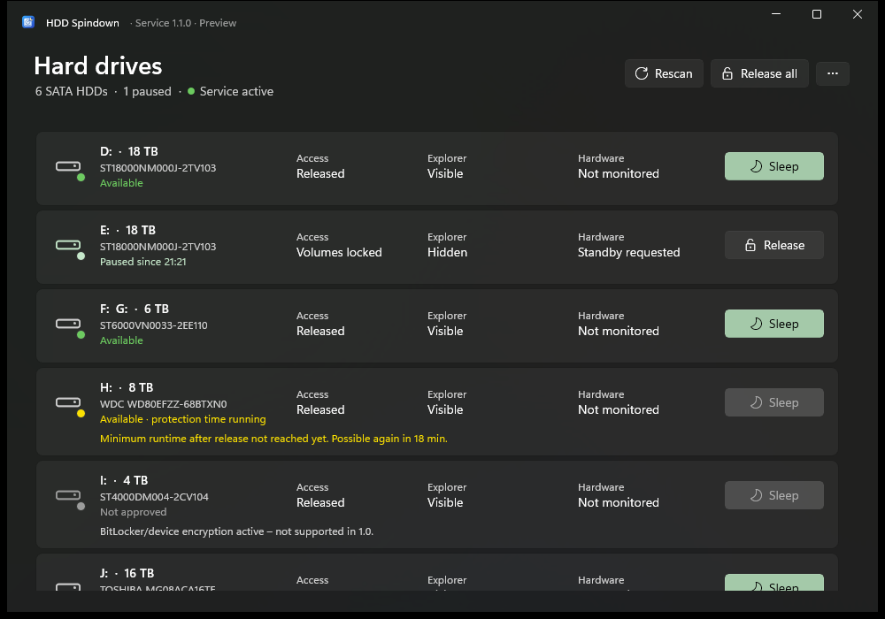
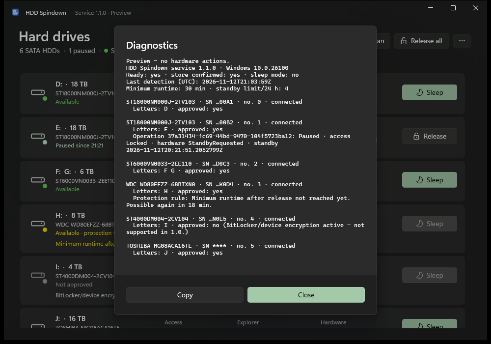
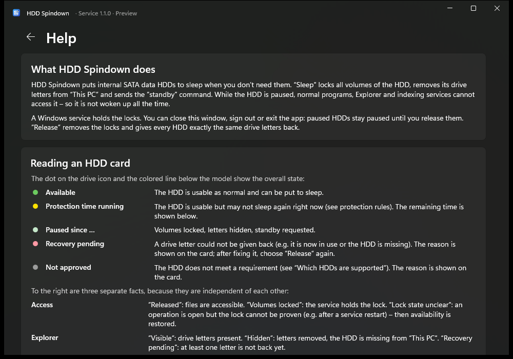

# HDD Spindown

**Put internal SATA data HDDs to sleep on Windows 10/11 – safely, and keep them asleep.**
[Deutsche Version](README.de.md)

<a href='https://ko-fi.com/D3U62AJLQD' target='_blank'></a>

HDD Spindown locks all volumes of a selected HDD, removes its drive letters from *This PC* and sends ATA STANDBY IMMEDIATE. While the drive is paused, Explorer, indexers and ordinary programs cannot touch it, so it is not woken up again every few minutes. **Release** gives every HDD exactly the same drive letters back.

A **Windows service** holds the locks. You can close the window, sign out or exit the app – paused HDDs stay paused. After a service crash, a restart or a power failure the service restores the original drive letters at the next start, based on a write-ahead journal. Drive letters that are in use are never overwritten.



> **Status:** 1.1.0 release candidate. The safety core is tested in simulation and against the real Windows storage stack with disposable VHDs. Hardware qualification on many HDD models and a long-term pilot are still pending – see [Limitations](#limitations).

## Screenshots

| Diagnostics | Built-in help |
|---|---|
|  |  |

<sub>Screenshots from the preview mode (HDD Spindown.exe --demo) with simulated drives.</sub>

## Features

- Windows 11 style app (WinUI 3, Mica, accent color, light/dark), **German and English**, switchable at runtime
- Notification area icon with Sleep/Release per HDD; starts with Windows
- Three separate facts per HDD: **access** (locked/released), **Explorer** (visible/hidden), **hardware** (standby requested/unknown) – the motor state is never polled, so the drive is not woken
- Protection rules against rapid start/stop cycles: at least 30 minutes of runtime after a release, at most 4 standby requests per 24 hours (conservative defaults, not manufacturer limits)
- Recovery without UI: `HddSpindown.Recovery.exe` (status, list, recover, export, import of 0.3.x journals)
- Installer with language selection (Setup.exe) or plain MSI; uninstall/upgrade is blocked while an operation cannot be restored

## Installation

1. Download `HDD-Spindown-<version>-Setup.exe` from [Releases](../../releases).
2. Run it, choose **Deutsch** or **English** and confirm the administrator prompt.
3. Open *HDD Spindown* from the Start menu. The app itself runs **without** administrator rights; only members of the local Administrators group may control HDDs.

The files are not code-signed yet, so Windows SmartScreen may show a warning (“More info” → “Run anyway”). Check the SHA-256 against `SHA256SUMS.txt` in the release.

Unattended: `Setup.exe /lang en /quiet` or `msiexec /i HDD-Spindown-<version>-x64.msi TRANSFORMS=:1033 APPLANGUAGE=en /qn`.

## Supported drives

Internal HDDs attached directly via SATA, GPT partition table, simple error-free NTFS data volumes.

Not supported (shown with the reason, SSD/NVMe hidden): SSD/NVMe, USB, RAID/Storage Spaces, dynamic and MBR disks, disks with Windows, programs or the page file, BitLocker-encrypted volumes, volumes with the dirty bit set.

## How it stays safe

The rules from the [production concept](docs/PRODUKTIONSKONZEPT.md) (German) are enforced in the core:

- No standby without a successful lock of **all** volumes of the drive; nothing is closed or dismounted by force.
- No drive letter is removed before its restore data is durably written (two SHA-256-checked copies, intent records before every external step).
- The device identity (model, serial, firmware, GPT disk GUID, partition layout) is re-checked on the opened device before every action – never just a disk number or drive letter.
- After a crash, availability is restored; an old sleep request is **not** repeated. Conflicts (letter now taken, drive missing) stay open per drive and are reported, never guessed.
- The service exposes a local named pipe with a small fixed set of commands (no paths, ATA commands or scripts); clients verify that the pipe belongs to the registered service.

## Emergency recovery

In a command prompt **as administrator**:

```text
sc stop HddSpindown                                      (restores all drive letters while stopping)
"C:\Program Files\HDD Spindown\Service\HddSpindown.Recovery.exe" status --lang en
"C:\Program Files\HDD Spindown\Service\HddSpindown.Recovery.exe" recover --lang en
sc start HddSpindown
```

The built-in help (`…` → *Help*, or F1) explains every state and situation.

## Building

Requirements: Windows 10/11 x64, .NET 8 SDK. NuGet packages (Windows App SDK, WiX 5) are restored automatically.

```powershell
powershell -ExecutionPolicy Bypass -File .\Build.ps1                    # translation check, core tests, MSI, Setup.exe
powershell -ExecutionPolicy Bypass -File .\Build.ps1 -IntegrationTests  # plus VHD tests against the real storage stack (UAC)
```

Output in `out\`: `HDD-Spindown-<version>-Setup.exe`, `HDD-Spindown-<version>-x64.msi`, `SHA256SUMS.txt`.

| Project | Purpose |
|---|---|
| `src/HddSpindown.Core` | State machine, durable journal, protection rules, IPC protocol, language catalog |
| `src/HddSpindown.Windows` | Windows adapter: identity, GPT, volumes, locks, mount manager, ATA standby; pipe client |
| `src/HddSpindown.Service` | Windows service, named pipe with ACL, power/shutdown events, logging |
| `src/HddSpindown.Recovery` | Console recovery tool using the same core |
| `src/HddSpindown.App` | WinUI 3 app with tray icon and built-in help |
| `tests/` | Simulated core tests (incl. real process kills) and VHD integration tests |
| `installer/`, `setup/` | WiX 5 MSI (de-DE + en-US transform) and the language-selection Setup.exe |

Translations: German source text is the key; English lives in `src/HddSpindown.Core/Localization*.cs`. `tools/Check-Localization.ps1` fails the build on missing or duplicate entries.

## Limitations

- **Hardware qualification:** ATA standby, release and wake-up behaviour must be verified on each HDD model/controller. The protection rules are generic defaults.
- The motor state is not measured; tools with direct device access (SMART tools, controller software) can still wake a paused drive – the lock stays in place.
- Not code-signed yet. No maintenance locks for running backups/SMART tests yet.
- **Not a substitute for a backup.** No guarantees about drive lifetime.

Test details: [docs/TEST-REPORT.md](docs/TEST-REPORT.md) (German). Changes: [CHANGELOG.md](CHANGELOG.md).

## Support

If HDD Spindown is useful to you, you can support its development:

<a href='https://ko-fi.com/D3U62AJLQD' target='_blank'></a>

## License

[MIT](LICENSE) – provided “as is”, without warranty of any kind.
